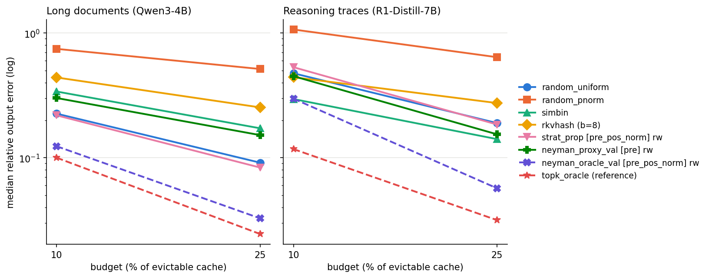

# NeymanKV offline experiments: T-1, T0, T1

> **⚠ Erratum (added 2026-10-11): all reasoning-trace results in this report are INVALID.** The 15 reasoning
> captures were generated with `DeepSeek-R1-Distill-Qwen-7B` loaded through `AutoTokenizer` under transformers 5.7. That
> loads the repo's `LlamaTokenizerFast` as a rebuilt `LlamaTokenizer` that drops the byte-level pre-tokenizer, so
> **every space was removed from the prompts** ("Hello world" became "Helloworld"). The traces are the model's response
> to garbled problems. Every `reasoning` row, column, and statement below (Gate A reasoning captures, T-1, T0, T1, the
> reasoning half of Gate E, the right-hand plot panel, surprise 5) is kept for the record but must not be used. A
> re-capture (~45 GPU-min) is deferred to the exhaustive phase. **The long-document results (Qwen3-4B, whose `Qwen2Tokenizer`
> is unaffected) stand.** Fix: `capture/run_capture.py::load_tokenizer` loads `tokenizer.json` via
> `PreTrainedTokenizerFast` and asserts an exact encode/decode round trip.

**Question.** When the KV cache is split into SimHash strata, does allocating the budget by output variance
(Neyman) beat allocating by stratum size (proportional, SimBin's rule)? Do values need to be part of that variance?

**Short answer.**
- *With oracle spreads S_h* (from the held-out future queries): yes, by a wide margin. Neyman on
  `pre_pos_norm` strata cuts median relative output error 43–69% vs proportional allocation at the same strata
  and 37–70% vs uniform random (both prompt types, both budgets). Value-aware S_h is modestly better than key-only on long docs (0.124 vs 0.145 at 10%).
- *With the attention-free proxy S_h* (Gaussian model of the last 256 observed queries): **no on long documents**.
  Every proxy configuration is *worse* than plain uniform random sampling (33–124% higher error) and worse than proportional.
  *(The reasoning-trace numbers, −7% to +31% vs uniform random, are INVALID; see erratum.)*
- **Gate E passes as literally specified, but only because the specified baseline (`random_pnorm`) is very weak on these
  keys.** Against uniform random or proportional-with-reweighting, the proxy fails on long documents. The oracle passes
  against every baseline. **The bottleneck is the S_h proxy, not Neyman allocation.**

All numbers below come from the CSVs in `runs/`. Primary statistic: per (prompt, layer, KV head), the error is
averaged over held-out queries and over seeds, and the median is taken over heads.

---

## 1. Setup

| | |
|---|---|
| Capture model | `Qwen/Qwen3-4B`, bf16, SDPA (36 layers, 8 KV heads, 32 Q heads, d=128). Layers kept: 0,4,…,32 |
| Reasoning model | `deepseek-ai/DeepSeek-R1-Distill-Qwen-7B`, bf16, SDPA (28 layers, 4 KV heads, 28 Q heads). Layers kept: 0,4,…,24 |
| Long docs (25) | 20 GovReport test reports, 4,000–7,600 tokens (`ccdv/govreport-summarization`), + 5 synthetic needles (passcode at random depth 10–90% in GovReport filler). Qwen3-4B answered **5/5** needles correctly |
| Reasoning (15) — **INVALID (garbled prompts, see erratum)** | MATH500 level ≥4 problems, T=0.6, top-p 0.95, ≤4,096 new tokens. Trace lengths 1,579–4,096; **8/15 hit the 4K cap** |
| Cut | Long docs: start of the question. Reasoning: 60% of the trace. Cache = tokens before the cut. Held-out queries: the next 512 positions × all grouped Q heads (2,048 per KV head for Qwen3, 3,584 for R1). Observed queries: the 256 positions before the cut |
| Always kept | First 4 + last 64 cache tokens, for every method. Budget = 10% / 25% of the remaining (evictable) tokens |
| GPU time | Capture 843 s (docs) + 2,711 s (reasoning) ≈ 1.0 GPU-h. T-1/T0/T1 ≈ 2.5 h light GPU use (fp32 matmuls) |
| Hardware/software | NVIDIA A30 24 GB, torch 2.11.0+cu130, transformers 5.7.0, Python 3.10.20. flash-attn skipped (no wheel for torch 2.11/cu130; a source build exceeds 10 min) |

Code: `capture/` (hooks, generation), `strata/` (RoPE, SimHash), `alloc/` (allocation, Webster, selection, S_h),
`estimate/` (estimator, R-KVHash replica, method engine), `experiments/` (T-1, T0, T1 drivers), `tests/`.

## 2. Synthetic tests (all pass; `runs/synthetic_tests.txt`)

| # | Check | Result |
|---|---|---|
| 1 | Full-budget identity, all stratified and random methods, 4 heads, N=2,000, d=128 | max abs diff < 1e-5 ✔ |
| 2 | Reweighting identity (×4 duplicate cache, keep 1 per group, bias log 4) | < 1e-5 ✔ |
| 3 | Webster rounding: 500 random cases; sum == B, n_h ≤ N_h, floor ≥1 whenever feasible | ✔ |
| 4 | Reservoir 10,000 → 50, 2,000 trials | ✔ (see note) |
| 5 | Inverse RoPE math (< 1e-5), and hook-captured pre-RoPE K and Q == inverse-rotated post-RoPE K and Q on tiny random-init Qwen3 and Qwen2 models (fp32, < 1e-5). Hooks leave logits unchanged | ✔ |
| 6 | Neyman sanity: stratum with 10× value spread gets 117 slots (proportional: 25); error 2.26 vs 8.37 | ✔ |

Extra tests added during the run: exact inclusion probabilities of the PPS sampler; Neyman with zero-spread strata.

*Note on test 4:* a per-token ±20% band over 2,000 trials is impossible (10 expected hits per token, about 32% binomial
noise). The ±20% check is applied to blocks of 100 consecutive stream positions (1,000 expected hits each). Every block passes, and early vs late positions are equal within 10%.

## 3. Gate A: PASS (`runs/gate_a.csv`)

All 40 captures (13 GB fp16 safetensors + JSON) reload with the expected shapes and finite values. All 40 prompts
have ≥3 layers passing (in fact all layers pass). The real tensors are bf16, so the synthetic 1e-5 absolute
tolerance cannot apply. Two checks replace it:
- **HF replica:** rotating the captured pre-RoPE key with HF's bf16 op path reproduces the captured post-RoPE key
  for 99.9996% of elements (min over prompt-layers 99.9986%).
- **Inverse:** fp64 inverse rotation vs pre-RoPE key: median per-token relative error 2.0e-3 (max 8.8e-3). That is the
  bf16 rounding floor (2^-8 = 3.9e-3).

## 4. Gate C (T-1): CONTINUE (decided on long_doc; reasoning rows INVALID) (`runs/t_minus_1.csv`, `runs/t_minus_1.md`)

Median predicted gain CV²/(1+CV²) over `pre`/`pre_pos_norm` strata, all bits:

| prompt type | gain_key | gain_val |
|---|---|---|
| long_doc | 0.627 | 0.456 |
| reasoning | 0.678 | 0.438 |

Both are far above 0.15. The brief's rules overlap here: gain_val ≥ 0.15 (continue with values), *and*
gain_val does not exceed gain_key by ≥ 0.03 (key-only). The two gains measure different variances (attention weights vs
attention output), so they are not comparable. T1 therefore ran both, and measured error decided (§6).
By layer, gains are smallest in layer 0 (0.05 long-doc) and largest in deep layers (0.93–0.96 for key at layers 28–32).

## 5. T0: R-KVHash scorer on real keys (reasoning columns INVALID) (`runs/t0_rkvhash.csv`, `runs/t0_rkvhash.md`)

The replica follows `kvpress/presses/rkv_press_lsh.py` (branch `dixi/rkv_lsh`) line by line: bf16 normalization and
projection, `torch.randn(d, b)` shared across heads, bf16 `scatter_add_` counts, (counts @ cos(Ham/b) − counts)/N,
bf16 softmax, top-budget.

Medians per head:

| | long_doc b=6 | long_doc b=8 | reasoning b=6 | reasoning b=8 |
|---|---|---|---|---|
| distinct bf16 scores (of ~5,900 / ~2,460 tokens) | 14 | 17 | 14 | 16 |
| tokens tied at the 10% cutoff | 857 | 633 | 224 | 280 |
| kept slots decided by `topk` tie-breaking, 10% | 243 / 592 | 225 / 592 | 91 / 246 | 111 / 246 |
| largest bucket, true count | 974 | 517 | 203 | 108 |
| largest bucket, code's bf16 count | **256** | **256** | 203 | 108 |
| Spearman(R, bucket occupancy) | 0.13 | 0.15 | −0.12 | 0.29 |
| evicted tokens that are singletons (10%) | 0.02% | 0.4% | 0.04% | 1.4% |
| mean_err @10% / @25% | 0.446 / 0.272 | 0.440 / 0.253 | 0.455 / 0.265 | 0.442 / 0.274 |

Findings:
- **Scores are almost entirely ties.** After the bf16 softmax over thousands of tokens, a head has 14–17 distinct
  values. About 40% of the kept slots at a 10% budget are decided by `torch.topk`'s tie-breaking, which is implementation-defined, not by the score.
- **bf16 counts saturate at 256.** `scatter_add_` of ones in bf16 stops at 256 (256+1 rounds to 256), so on long
  documents the code cannot distinguish a 300-token bucket from a 974-token one.
- **Outlier eviction is a non-issue** at these sizes: singleton buckets hold <1.5% of tokens.
- Redundancy correlates only weakly with bucket occupancy (Spearman −0.12 to 0.29), because of the ties and saturation.
- With `lam=0` the code keeps the *highest*-redundancy scores. That is what "keep the top-budget scores" says, and it is literally
  what `compress_decoding` does. The code's default `lam=0.1` (attention from the last 8 queries minus 0.9·redundancy) is much
  better: 0.316 / 0.211 at 10% (long_doc / reasoning). It is reported in T1 as `rkvhash_lam0.1`.

## 6. Gate E (T1): long_doc half only; the reasoning half cannot be evaluated (INVALID captures)

`runs/t1_results.csv` (688,200 rows), `runs/t1_summary.md`, `runs/t1_summary.csv`.

### Gate E as specified (reduction vs `random_pnorm`)

| method (rw on) | strata | long @10% | long @25% | reas @10% | reas @25% | passes |
|---|---|---|---|---|---|---|
| random_pnorm (baseline) | – | 0.746 | 0.515 | 1.067 | 0.640 | |
| neyman_proxy_key | pre | 0.311 (+58%) | 0.158 (+69%) | 0.417 (+61%) | 0.147 (+77%) | ✔ |
| neyman_proxy_key | pre_pos_norm | 0.453 (+39%) | 0.205 (+60%) | 0.476 (+55%) | 0.131 (+80%) | ✔ |
| neyman_proxy_val | pre | 0.301 (+60%) | 0.152 (+70%) | 0.451 (+58%) | 0.154 (+76%) | ✔ |
| neyman_proxy_val | pre_pos_norm | 0.445 (+40%) | 0.198 (+62%) | 0.509 (+52%) | 0.133 (+79%) | ✔ |
| neyman_oracle_val | pre_pos_norm | 0.124 (+83%) | 0.033 (+94%) | 0.298 (+72%) | 0.057 (+91%) | ✔ |

### Why the literal pass is not the real answer

`random_pnorm` is a poor sampler on these keys, even after I fixed my first implementation of it (see §8, item 1).
Qwen post-RoPE key norms make s_i = ‖k_i‖²/(2√d) span hundreds of nats within one head. Sampling ∝ e^{s_i} therefore
puts inclusion probability 1 on the largest-norm tokens and essentially zero on most of the rest. The resulting
importance weights are extreme. Uniform random sampling with reweighting is 3× better (0.226 vs 0.746 at 10%).

Against the stronger baselines:

| median error | long @10% | long @25% | reas @10% | reas @25% |
|---|---|---|---|---|
| random_uniform | 0.226 | 0.091 | 0.476 | 0.190 |
| strat_prop [pre] rw | 0.201 | 0.080 | 0.514 | 0.177 |
| **neyman_proxy_val [pre] rw** | 0.301 (**−33%** vs uniform) | 0.152 (**−66%**) | 0.451 (+5%) | 0.154 (+19%) |
| neyman_proxy_key [pre] rw | 0.311 (−38%) | 0.158 (−73%) | 0.417 (+12%) | 0.147 (+22%) |
| neyman_proxy_key [pre_pos_norm] rw | 0.453 (−101%) | 0.205 (−125%) | 0.476 (0%) | 0.131 (+31%) |
| **neyman_oracle_val [pre_pos_norm] rw** | **0.124 (+45%)** | **0.033 (+64%)** | **0.298 (+37%)** | **0.057 (+70%)** |
| topk_oracle (reference) | 0.100 | 0.025 | 0.117 | 0.032 |
| rkvhash_lam0.1 (extra) | 0.316 | 0.139 | 0.211 | 0.089 |
| simbin (as published) | 0.340 | 0.172 | 0.296 | 0.141 |

(Percentages: improvement vs random_uniform; negative = worse.)

If Gate E used `random_uniform` as the baseline, the proxy would **fail** on long documents (it is worse than
uniform at both budgets) and the oracle would **pass**. Per the brief: *the oracle passes and the proxy fails, so
the problem is the S_h proxy.* The extra variant `neyman_observed_*` takes S_h from the observed queries' actual causal
attention, with no Gaussian model. It is also worse than uniform on long documents (0.244 / 0.112 for val [pre]). So the
gap is mostly **observed queries are a poor predictor of future queries' attention** on long documents, especially
across the question boundary, rather than an artifact of the Gaussian approximation. On reasoning traces, where the
next 512 queries continue the same trace, both proxies help (best non-oracle stratified method: neyman_observed_val
[pre_pos_norm] at 25%, 0.092).

### Required ablations (median error; long_doc 10% / 25% | reasoning 10% / 25%, reasoning INVALID)

**Reweighting on vs off (fixed allocation):** reweighting is essential on long documents and mixed on reasoning.

| | rw on | rw off |
|---|---|---|
| strat_prop [pre] | 0.201 / 0.080 \| 0.514 / 0.177 | 0.388 / 0.201 \| 0.423 / 0.228 |
| neyman_oracle_val [pre_pos_norm] | 0.124 / 0.033 \| 0.298 / 0.057 | 0.318 / 0.119 \| 0.313 / 0.102 |
| neyman_proxy_val [pre] | 0.301 / 0.152 \| 0.451 / 0.154 | 0.400 / 0.227 \| 0.388 / 0.199 |

On reasoning at 10%, the un-reweighted versions are sometimes *better*. Reweighting by N_h/n_h inflates the weight of
1-slot strata, and reasoning heads have heavy recency structure.

**Proportional vs Neyman (fixed strata, rw on):**

| strata | proportional | Neyman oracle (val) | Neyman proxy (val) |
|---|---|---|---|
| pre | 0.201 / 0.080 \| 0.514 / 0.177 | 0.152 / 0.052 \| 0.339 / 0.098 | 0.301 / 0.152 \| 0.451 / 0.154 |
| pre_pos_norm | 0.219 / 0.083 \| 0.532 / 0.185 | 0.124 / 0.033 \| 0.298 / 0.057 | 0.445 / 0.198 \| 0.509 / 0.133 |

**post vs pre strata (proportional, rw on):** post 0.216 / 0.085 \| 0.511 / 0.179; pre 0.201 / 0.080 \| 0.514 / 0.177;
pre_pos_norm 0.219 / 0.083 \| 0.532 / 0.185. Under proportional allocation, the choice of strata barely matters (within 8%).
Strata matter only once allocation uses S_h.

**key vs val S_h (rw on):** val is better with the oracle on long docs (0.124 vs 0.145 [ppn] at 10%, 0.152 vs 0.168 [pre])
and roughly tied on reasoning (0.298 vs 0.325 at 10%, 0.057 vs 0.056 at 25%). With the proxy, key and val are within ±8%
of each other everywhere. Values help by about 10–15% when S_h is accurate.

**Within-stratum selection (extra):** systematic vs random on neyman_proxy_val [ppn] rw: 0.446 vs 0.445 / 0.192 vs 0.198 \|
0.492 vs 0.509 / 0.129 vs 0.133. No meaningful difference.

### Tail errors and attention-mass recall disagree with mean error

- p95 over queries (long @10%): neyman_oracle_val [ppn] 0.42, random_uniform 0.71, strat_prop [pre] rw 0.68,
  neyman_proxy_val [pre] 0.99, random_pnorm 2.43.
- **Mass recall and output error disagree.** neyman_proxy_key [pre] keeps more attention mass than uniform (0.687 vs
  0.589 at 10%, long docs) yet has higher error (0.311 vs 0.226). `rkvhash_lam0.1` has mass recall 0.773 but error 0.316.
  Reweighting changes error by about 2× while mass recall is identical by construction (same kept set). Mass recall is not a
  usable proxy for output error once reweighting is in play.

## 7. Surprises

1. **Pre-RoPE (and layer-0) keys are nearly collinear.** At b=8, layer 0 has a median of 6 (long docs) or 1 (reasoning) non-empty
   pre-RoPE buckets, and 8 / 2 post-RoPE. In deeper layers, pre-RoPE buckets are 30–40% fewer than post-RoPE (e.g. 106 vs 171
   median at b=8). The SimHash geometry SimBin and R-KVHash rely on is degenerate in early layers.
2. **R-KVHash in bf16 is decided mostly by ties** (§5), and its bf16 counts saturate at 256.
3. **The norm-proportional sampler is near-deterministic on Qwen keys.** s_i spans more than 745 nats in some heads, beyond
   float64's `exp` range. My first implementation (`random_pnorm_naiveHT`, median error 4.2) used the uncapped approximation π_i ≈
   B·e^{s_i}/Σe^{s}, which breaks completely here.
4. **On long documents, observed-query proxies are worse than no proxy at all.** Uniform random is better than either proxy, even though the oracle shows
   a 45–64% opportunity.
5. *(INVALID: reasoning captures)* **On reasoning, deterministic methods with recency do well:** SimBin (keeps newest) beats every proxy-Neyman method at 10% (0.296),
   and rkvhash_lam0.1 is the best non-oracle method on reasoning (0.211 / 0.089).

## 8. Deviations from the brief, choices, and fixes (all deliberate; flagged here)

1. **`random_pnorm` implementation.** Final version: inclusion probabilities π_i = min(1, c·e^{s_i}) with Σπ = B (c solved in
   log space), fixed-size systematic PPS sampling in random order (exact π_i, tested), and bias −log π_i. This equals the brief's
   compensating logit −s_i plus a constant. The constant is needed because the always-kept tokens have bias 0. The first
   version is kept as `random_pnorm_naiveHT`.
2. **S_h uses normalized attention weights** p_i(q) = w_i/Σw, so every query has equal weight when averaging S_h over
   queries. Raw exp-logits would let a handful of high-logit queries dominate. The proxy normalizes E[w_i] the same way and
   treats it as a single "query".
3. **`neyman_val` follows the brief literally** (std over tokens of ‖p_i(v_i − o)‖). The T-1 CSV also reports
   `valvec`, the trace-covariance version that is the textbook vector Neyman spread. Its gains are within ±0.02 of `val`.
4. **Bits rule.** b ∈ {4,6,8} chosen so the number of *cells* (2^b, ×12 for `pre_pos_norm`) is closest in log2 to budget/4.
   Long doc @10% → pre b=8 / ppn b=4; @25% → pre b=8 / ppn b=6.
5. **GovReport "question"** = "Summarize the main findings and recommendations of the report above." (GovReport has no questions).
   Future queries = the question tokens + greedily generated answer tokens, with `min_new_tokens` forcing 512 positions past the cut.
6. **Water-filling fix.** If proxy weights underflow to zero in some strata (seen in reasoning layer 0, where `pre_pos_norm`
   has 12 strata and 11 had S_h = 0), every stratum with positive S_h is capped and the remainder goes to the zero-spread strata by size.
   The first T1 run crashed there. Reasoning prompts were rerun after the fix. Long-doc results could not be affected, since that
   path would have crashed.
7. **Extras, not in the brief and not used for any gate:** `neyman_observed_{key,val}`, `rkvhash_lam0.1`, `systematic`
   within-stratum, `valvec`.
8. Synthetic test 4 tolerance applied to blocks (§2). Gate A tolerances adapted to bf16 (§3).

## 9. Determinism

- Seeds fixed everywhere (`common.seed_all`). Per-method RNG = `default_rng([seed, layer, head, budget%])`.
- `torch.use_deterministic_algorithms(True, warn_only=True)` with `CUBLAS_WORKSPACE_CONFIG=:4096:8`. **warn_only** was needed
  because SDPA and `index_add_`/`scatter_add_` have no deterministic CUDA kernels for every path.
- **Not guaranteed deterministic:** (a) reasoning traces (sampled generation; seeded, but CUDA kernel selection can change
  bits across driver/library versions); (b) `torch.topk` tie-breaking in R-KVHash (implementation-defined, and it decides about 40% of kept slots);
  (c) GPU float-atomic `index_add_` in the S_h statistics (last-bit differences only). bf16 `scatter_add_` of ones is
  order-independent, so the saturation at 256 is reproducible.

## 10. Recommendation

Neyman allocation over SimHash strata is worth pursuing only with a better S_h estimator. Two directions: (i) estimate S_h from
the *upcoming* queries as they arrive (online or periodic re-allocation), not from a pre-cut window; (ii) find a query-free spread
proxy and validate it against the oracle S_h directly (rank correlation of proxy vs oracle S_h per head), before running any eviction.
Keep reweighting. Without it, every stratified method loses most of its advantage on long documents.

---
<!-- provenance -->
- git commit: `4033bd94e6c18770596c2474032f13aaea34e63c` (dirty=True)
- GPU: NVIDIA A30; python 3.10.20; torch 2.11.0+cu130
- pip freeze: 193 packages, full list in `runs/pip_freeze.txt`
