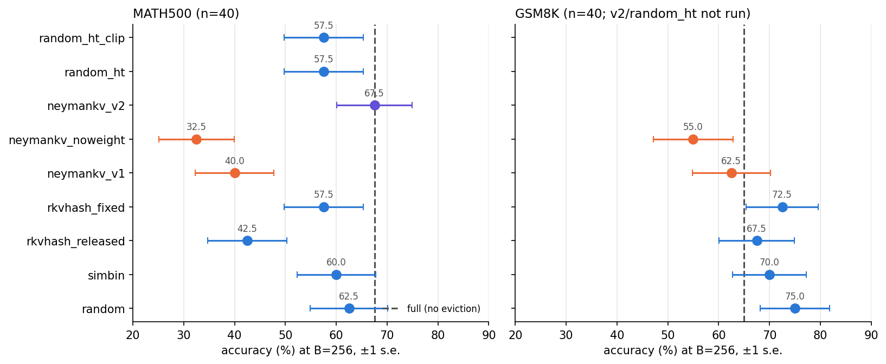
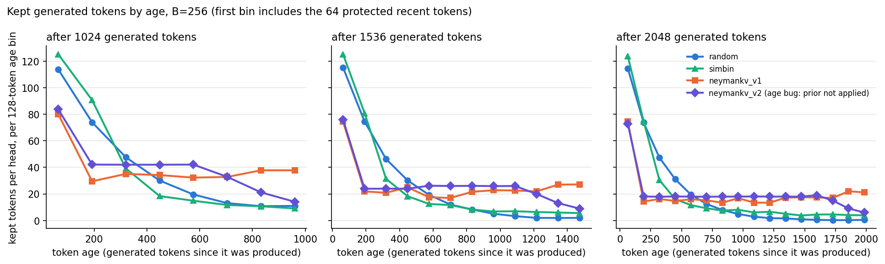

# NeymanKV proof of concept: decode-time eviction on reasoning traces (R1-Distill-Qwen-1.5B, A30, 5 GPU-h)

**Verdict: FAIL for NeymanKV v1.** On MATH500 at B=256 it scores 40.0% vs 62.5% for `random`, 60.0% for `simbin`,
and 57.5% for `rkvhash_fixed`. It hits the 3,072-token cap on 57.5% of traces vs 30% for `random`. The `noweight`
ablation is about as bad (32.5%). The cause is confirmed by the age histogram: v1 holds the distant past at the same
density as the recent past, while every baseline that works is recency-biased.
**Post-hoc `neymankv_v2`** (explicit recency prior, MATH only, one run) reaches 67.5%, equal to `full` and +5 over
`random`. That gap is 2 problems, well inside noise. It loses the retention probe (0/20).
**AgeKV Phase 1:** `random_ht` and `random_ht_clip` both score 57.5% (−5 vs `random`). That falls between the brief's
two thresholds: not within 3 points, not a loss of more than 7.

Every number is from `results.csv` / `per_problem.csv` / `run_stats.csv` in this directory. All baselines are
in-harness numbers, not paper numbers.

## 1. Setup

| | |
|---|---|
| Model | `deepseek-ai/DeepSeek-R1-Distill-Qwen-1.5B`, bf16 (28 layers, 12 Q / 2 KV heads, d=128) |
| Data | 40 MATH500 (seed 0, 8 per level 1–5), 40 GSM8K test (seed 0), 20 GSM8K for each probe |
| Decoding | T=0.6, top-p 0.95, one seed per problem (per-slot generator), max 3,072 new tokens, stop at EOS or `</think>` + closed `\boxed{}` |
| Engine | own decode loop over the HF modules (`poc/engine.py`): KV cache [layer, slot, kv-head, capacity] with a per-token additive logit bias; original positions kept (post-RoPE keys stored, never renumbered); continuous refill of finished slots; batch 8 per process, 4–6 processes in parallel |
| Attention | SDPA with the bias as an additive float mask (see §2.2 for why not eager) |
| Compression | every 64 decode steps; protected set = whole prompt (includes the first 4 tokens) + last 64 generated tokens; candidates cut back to B. Post-compression cache = P + B + 64 for every method (`kept_set_log.csv`: 320 generated tokens per head at every compression, all methods except `rkvhash_released`, whose prompt is evictable) |

### 2.1 Tokenizer workaround (transformers 5.7)
`AutoTokenizer.from_pretrained("deepseek-ai/DeepSeek-R1-Distill-Qwen-{1.5B,7B}")` returns a rebuilt `LlamaTokenizer` that
drops the byte-level pre-tokenizer in `tokenizer.json`. **Every space disappears**: "Hello world, the answer is 42" is
encoded as "Helloworld,theansweris42". We load `PreTrainedTokenizerFast.from_pretrained(...)` and assert an exact
encode/decode round trip before any run (`poc/run.py::load_tokenizer`). **Anyone reproducing R-KVHash (or any
R1-Distill result) under transformers 5.7 with `AutoTokenizer` hits this silently.** The first S1 attempt (GPU clock
0h15m–1h05m, full-cache accuracy 20%) used the broken tokenizer. It is quarantined in `invalid_tokenizer_bug/`.

### 2.2 bf16 eager attention corrupts this model
HF "eager" attention computes `matmul(q, k^T) * scale` in bf16, rounding scores before the fp32 softmax. This model's
attention logits are large (bf16 spacing is 1.0 near 128), and greedy decoding under eager writes "80 divided by 2 is 44".
SDPA-bf16, fp32 and fp16 all write "…which is 40" (`eager_bug.md`). Weights load exactly (339/339 tensors bit-identical).
The engine first copied eager semantics, and matched HF eager, so the equivalence check could not catch it. The second
S1 attempt (1h11m–2h10m) is quarantined in `invalid_eager_bf16/`. **kvpress-style code that runs eager to obtain
attention weights would hit the same collapse on this model family in bf16.**

## 2. Equivalence checks (`equivalence.json`, final run on the SDPA engine)

| check | result |
|---|---|
| Engine vs HF-SDPA incremental decoding, 50 teacher-forced tokens | max logit diff 0.25, argmax agreement 50/50 |
| 1. Budget ≥ trace length: every method produces the same tokens as `full` (3 prompts) | 7/7 identical ✔ |
| 2. `neymankv_v1` with one stratum, no floor vs `random`: kept-set size per head at every compression | identical at all 7 compressions ✔ |
| 3. Logit bias: one copy + bias log 4 vs 4× duplicated cache | fp32 model: rel diff 4e-7 ✔. bf16: rel diff 1.0e-2 (bf16 noise floor of this model, see below) |

**Where the 0.25 logit gap comes from** (`logit_gap_diagnostic.json`, measured on the earlier eager-semantics engine):
with HF's GEMM shapes (repeat KV to all 12 Q heads), decode-step hidden states are **bit-identical** to HF at all 28 layers
and all 50 steps. The whole gap comes from our grouped GEMM ([2 KV heads × 6 queries]), which reduces in a different bf16
order. First differences appear at layer 0–17 depending on the step and grow to ≤6% relative at layer 27 (0.25 on a top
logit of 32). Recommendation for the exhaustive phase: use the HF-shaped path (flag `hf_shape_attn`), or accept this as noise.

## 3. Results (B=256)

| method | MATH500 acc | GSM8K acc | MATH mean / p95 len | MATH cap rate | forced probe: recall cue | forced probe: restated | tok/s/process |
|---|---|---|---|---|---|---|---|
| full | **67.5%** | 65.0% | 2131 / 3072 | 25% | **100%** | 5% | 57 |
| random | 62.5% | **75.0%** | 1985 / 3072 | 30% | 5% | 0% | 59 |
| simbin | 60.0% | 70.0% | 2046 / 3072 | 32.5% | 0% | 0% | 58 |
| rkvhash_released | 42.5% | 67.5% | 2368 / 3072 | 52.5% | 0% | 0% | 60 |
| rkvhash_fixed | 57.5% | 72.5% | 2239 / 3072 | 37.5% | 0% | 0% | 105 |
| **neymankv_v1** | **40.0%** | 62.5% | 2512 / 3072 | **57.5%** | 20% | 0% | 72 |
| neymankv_noweight | 32.5% | 55.0% | 2516 / 3072 | 62.5% | 25% | 0% | 74 |
| neymankv_v2 (post-hoc, MATH only) | 67.5% | n/a | 1953 / 3072 | 25% | 0% | 0% | 45* |
| random_ht (AgeKV P1.2) | 57.5% | n/a | 2227 / 3072 | 37.5% | n/a | n/a | 50* |
| random_ht_clip (AgeKV P1.3) | 57.5% | n/a | 2278 / 3072 | 40% | n/a | n/a | 60* |

n=40 per dataset, so one standard error is about ±7.5 points, and a difference between two methods has s.e. ≈ 10 points.
\*Run with 6 processes in parallel, so tok/s is not comparable. Peak memory 3.5–4.6 GB allocated per process
(`run_stats.csv`). Loop rate (a 4-gram repeated ≥8 times back to back) is 0 for every method. The literal definition never fires
on these traces; cap rate is the effective degeneration signal.

### Probes
- **Forced-prefix probe.** The template ends with `<think>\n`; we teacher-force `Note to self: the access code is 7391-KQ.\n\nOkay,`
  as generated (evictable) tokens. The recall instruction stays in the protected prompt. "Okay," was added because without it
  the model closes `</think>` right after the note and the trace stays too short to evict anything (`forced_prefix_variants.md`).
- **Scored as specified (code restated in the answer):** at most 5% for every method, `full` included. The 1.5B model mostly
  ignores the restate instruction, so this scoring has no headroom.
- **Recall cue (added):** after each trace, teacher-force `\n\nThe access code is` on the method's *evicted* cache and greedy-decode
  8 tokens. `full` 20/20. `random` 1/20. `simbin`, both R-KVHash 0/20. `neymankv_v1` 4/20, `noweight` 5/20, `neymankv_v2` 0/20.
  Uniform coverage (v1) retains old facts somewhat better. Every recency-biased method, v2 included, loses the fact.
- **Original probe (code in the protected prompt) as control:** not run; skipped by the 4h15m launch cutoff.

### Age histogram (bug check, P1.1): kept generated tokens per head by age, one MATH trace (`age_hist.json`)

`random` decays geometrically (114 → 74 → 48 → 30 → 20 tokens per 128-token age bin). `simbin` also decays steeply,
through its keep-newest rule. `neymankv_v1` is flat at about 15–20 per bin out to age 2,000. The plotted v2 curve is from a
*bugged* v2 (age computed from the compacted cache length, so the prior was never applied). That bug was found by this
histogram, fixed, and the v2 MATH run was relaunched. The v2 numbers in the table are from the fixed code; the bugged run
is in `superseded/`.

## 4. Verdict (brief §6, revised conditions)
- **Strong pass:** no. v1 is 22.5 points *below* `random` on MATH500, and its probe margin over random is +15 (recall cue), not ≥20.
- **Weak pass:** no. Accuracy does not tie random, loop rate is uninformative, and v1 beats `noweight` by only 7.5 points (within noise).
- **Fail:** yes. v1 is worse than random on accuracy and cap rate. Its only advantage (retention probe, +15) is below the bar.
  The no-weight ablation is within noise of v1.
- **Finding:** *uniform-coverage stratification is wrong for reasoning traces; coverage must sit inside a recency prior.* This
  explains why SimBin (keep newest in each bucket) and R-KVHash's eviction both survive: each is accidentally recency-biased.
- `neymankv_v2` (recency prior + strata + bias) applied to the strong-pass accuracy legs: +10 over `rkvhash_fixed`, +25 over
  `rkvhash_released`, +7.5 over `simbin`, +5 over `random`. But one run at n=40 does not resolve these gaps, and it fails the
  probe leg (0/20).

## 5. What was cut or changed because of the clock (or the bugs)
- ~2 GPU-h lost to the two harness bugs (§2.1, §2.2). Both quarantined runs are excluded from every table.
- **S3 (B=1024) dropped** (PI instruction, about 3h40m). The slot went to `neymankv_v2`.
- Original-probe control (7 runs), `random_ht`'s forced probe, and S4 (`neymankv_nofloor`) were skipped by the 4h15m cutoff.
- `neymankv_v2`, `random_ht` and `random_ht_clip`: MATH500 only. No GSM8K.
- Batch 8 per process as specified, but 4–6 processes ran in parallel to reach >300 tok/s aggregate (S1: 1.08M tokens).
- Forced-prefix text: "Okay," appended (see Probes). Recall-cue scoring added alongside the specified scoring.
- Single seed per problem throughout. No repeat runs.
